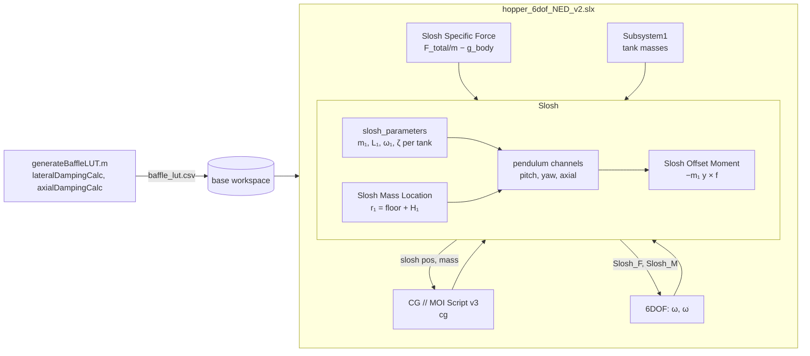

# Slosh Model — `hopper_6dof_NED_v2`

**Updated:** 2026-10-22
**Scope:** how the sim models propellant slosh in the LOx and RP-1 tanks (mechanical analog, damping and baffles, coupling into the vehicle), and how the model was validated.
**Reference tool:** SLOSH-ML v1.0.0 (Á. Romero-Calvo, Georgia Tech LGST lab), [lgst-lab/slosh_ml](https://github.com/lgst-lab/slosh_ml) @ `562e7ff`; theory from NASA SP-106 and Dodge 2000.
**Related:** [`MASS_PROPERTIES.md`](MASS_PROPERTIES.md) (rigid mass, CG and inertia, which already include all the propellant).

## 1. Overview

Each tank is a flat-bottom cylinder with a free liquid surface. Its first **lateral** slosh mode is modelled as a pendulum (NASA SP-106 / Dodge mechanical analog), with mass m₁, length L₁ and natural frequency ω₁ that vary with fill level and with the specific force (thrust ÷ mass).

**Formulation.** All the propellant, slosh mass included, is already in the rigid vehicle mass, CG and inertia (`MASS_PROPERTIES.md`). The Slosh subsystem therefore adds only the **correction loads** for the liquid not following the tank:

```
ÿ  = −f_lat − ω₁² y − 2 ζ ω₁ ẏ          pendulum, ω₁² = f_x / L₁
ΔF = −m₁ ÿ                               force on the vehicle, at the slosh-mass rest point r₁
ΔM = r₁ × ΔF − m₁ y × f                  moment about the CG (incl. the offset moment)
```

Here y = L₁φ is the bob displacement in body axes, f is the specific force at the tank, and ζ the damping ratio. To first order these are exactly the rod force of a pendulum hinged at r₁ + L₁x̂ (§4.3).

**Axisymmetric mode.** The first "axial" mode has its frequency and damping computed, but it carries **zero equivalent mass**: to first order it puts no force or moment on the tank (§3.2).

**Damping.** Lateral damping comes from a lookup table on propellant mass, generated offline from a smooth-wall plus ring-baffle model (§5). The adopted baffle design is **15 rings (LOx) and 11 rings (RP-1)**.

| Full tanks | LOx | RP-1 |
|---|---|---|
| Propellant | 16 kg, h = 0.383 m | 13 kg, h = 0.444 m |
| Slosh mass m₁ | 2.05 kg | 1.44 kg |
| Pendulum length L₁ | 0.0586 m | 0.0586 m |
| ω₁ at 1 g | 12.93 rad/s (2.06 Hz) | 12.93 rad/s (2.06 Hz) |
| Lateral damping ζ (baffled) | 0.043 | 0.047 |

## 2. Architecture



| Piece | File / block | Role |
|---|---|---|
| Damping table | `generateBaffleLUT.m` → `baffle_lut.csv`, `baffle_lut.mat` | ζ_lateral and ζ_axial vs propellant mass for each tank (fixed design §5.3) |
| Damping models | `lateralDampingCalc.m`, `axialDampingCalc.m`, `baffleThicknessFactor.m` | Smooth-wall and ring-baffle damping (§5.1) |
| Baffle sizing | `sweepBaffleDesign.m` (damping targets), `sweepBaffleSim.m` / `scoreBaffleSweep.m` (closed loop) | §5.2, §7.5 |
| Table load | `sim_setup.m` | Reads `baffle_lut.csv` into `ox_/fu_mass_profile`, `*_lateral_damping_ratios`, `*_axial_damping_ratios` |
| Drive signal | top level `Slosh Specific Force` | F_total/m − g_body: the non-gravitational acceleration at the CG |
| Parameters | `Slosh/MATLAB Function` (LOx), `MATLAB Function1` (RP-1) | m₁, L₁, ω₁ for the lateral and axisymmetric modes |
| Tank acceleration | `Slosh/Subsystem`, `Subsystem1` | f at the slosh-mass point: f_cg + ω̇ × r + ω × (ω × r) |
| Rest point | `Slosh/Ox Slosh Mass Location`, `Fu Slosh Mass Location` | r₁ = tank floor + H₁(fill) |
| Pendulums | `Slosh/Oxidizer|Fuel Pitch|Yaw|Axial Force` (6 channels) | Integrate φ, output ΔF = −m₁L₁φ̈ and displacement y = L₁φ |
| Moments | `Cross Product1/2`, `Ox/Fu Slosh Offset Moment`, `Sum5` | r₁ × ΔF and −m₁ y × f, summed into `Slosh_M` |
| Outputs | `Slosh_F`, `Slosh_M` → 6DOF; slosh pos/mass → `CG // MOI Script v3` | Loads on the vehicle; positions/masses only for the diagnostic `cg_with_slosh` / `MOI_with_slosh` |

## 3. Mechanical analog (`slosh_parameters`)

### 3.1 Lateral mode

Flat-bottom cylinder of radius R = 0.108 m with liquid height h = m/(ρπR²) and ξ = 1.841 (first root of J₁′). With g_eff = |f|:

```
ω₁² = (g_eff ξ / R) · tanh(ξ h / R)
m₁  = m · 2R tanh(ξ h / R) / (ξ (ξ² − 1) h)
L₁  = R / (ξ tanh(ξ h / R))                      (= g_eff / ω₁²)
H₁  = h − (2R/ξ) · tanh(ξ h / 2R)                rest height of m₁ above the floor
hinge = H₁ + L₁
```

These are evaluated every step from the current tank mass and specific force. The tank floors are the as-built ones (LOx 29.18 in, RP-1 18.91 in tall).

| Tank | Fill | h/R | ω₁ [rad/s] | m₁ [kg] | L₁ [m] | H₁ [m] | Hinge [m] |
|---|---|---|---|---|---|---|---|
| LOx | 5 % | 0.18 | 7.26 | 0.647 | 0.186 | 0.0002 | 0.186 |
| LOx | 10 % | 0.35 | 9.80 | 1.177 | 0.102 | 0.0013 | 0.103 |
| LOx | 25 % | 0.89 | 12.45 | 1.900 | 0.063 | 0.017 | 0.080 |
| LOx | 50 % | 1.77 | 12.92 | 2.044 | 0.059 | 0.083 | 0.142 |
| LOx | 100 % | 3.55 | 12.93 | 2.050 | 0.059 | 0.266 | 0.325 |
| RP-1 | 5 % | 0.21 | 7.78 | 0.520 | 0.162 | 0.0003 | 0.163 |
| RP-1 | 25 % | 1.03 | 12.64 | 1.374 | 0.061 | 0.024 | 0.086 |
| RP-1 | 50 % | 2.06 | 12.93 | 1.436 | 0.059 | 0.110 | 0.169 |
| RP-1 | 100 % | 4.11 | 12.93 | 1.438 | 0.059 | 0.327 | 0.385 |

Values are at 1 g. Heights are above the tank floor.

### 3.2 Axisymmetric (axial) mode

```
ω₀² = (g_eff ε₀₁ / R) · tanh(ε₀₁ h / R),   ε₀₁ = 3.8317 (first root of J₁)
m₀₁ = 0
```

The mode is axisymmetric and conserves volume (∫η dA = 0), so to first order it produces no net force and no net moment on the tank, and a potential-flow liquid exerts no roll torque. Its equivalent mechanical mass is therefore zero. The oscillator states, frequency and damping-table input are kept, so the subsystem interface is unchanged and the mode can be monitored, but it couples nothing into the vehicle. For full LOx, ω₀ = 18.7 rad/s.

## 4. Coupling into the vehicle

### 4.1 Drive signal

The pendulums are driven by the **specific force**: the non-gravitational acceleration, which is what an accelerometer would read. At the top level, `Slosh Specific Force` = F_total/m − g_body. The tank-point value adds the rotational terms: f = f_cg + ω̇ × r₁ + ω × (ω × r₁). The axial component sets g_eff, so ω₁ ≈ 13 rad/s in hover, and the lateral components excite the pendulums.

### 4.2 Pendulum channels

Each tank has three channels with the same structure. **Pitch** and **yaw** are the lateral pendulum in the body z and y directions; **axial** is the zero-mass mode. Each channel integrates

```
φ̈ = −f_lat / L − ω² φ − 2 ζ ω φ̇
```

and outputs the force on the vehicle ΔF = −m·L·φ̈ = −m·ÿ, the displacement y = L·φ, and the mass. Damping ζ comes from the damping table at the current tank mass. The per-pendulum torque blocks (`MATLAB Function4`) output zero: a pendulum analog is a point mass on a frictionless hinge and transmits no moment of its own, and the liquid's rigid-body inertia is already in the vehicle inertia.

### 4.3 Load application

The force ΔF acts at the slosh-mass rest point r₁, and the subsystem adds the offset moment explicitly:

```
Slosh_F = Σ_tanks ΔF
Slosh_M = Σ_tanks [ r₁ × ΔF  −  m₁ y × f ]
```

**Why at r₁ and not at the hinge.** The physical rod force acts at the hinge r_h = r₁ + L₁x̂. Moving ΔF from the rest point to the hinge gives the same moment, because r_h × ΔF + L₁x̂ × F_rigid = r₁ × ΔF − m₁ y × f_x x̂ when ω₁²L₁ = f_x. But with m₁ already rigid at r₁, applying ΔF at the hinge *alone* would drop the L₁x̂ × F_rigid term. The model therefore applies ΔF at r₁ and adds −m₁ y × f explicitly.

**Not in the CG/inertia.** The offset moment −m₁ y × f is the dynamic effect of the slosh CG shift, so the slosh displacement is not fed into `CG // MOI Script v3`. Doing so would count it twice. The slosh-inclusive CG and inertia are logged as diagnostics only (`cg_with_slosh`, `MOI_with_slosh`). The full argument is in `MASS_PROPERTIES.md` §5, "Why slosh is not fed into CG // MOI".

## 5. Damping and baffles

### 5.1 Damping models

**Lateral** (`lateralDampingCalc.m`), at wall slosh amplitude η = 0.1R:

- **Smooth wall:** ζ_s = (c₁ / 2R)·√(ν / 2ω), with c₁ from a fill-dependent correlation table.
- **Ring baffles:** an energy-dissipation sum over the submerged rings. Each ring is weighted by the potential-flow mode shape at its height, cosh(k·z)/cosh(k·h) with k = ξ/R (1 at the free surface, decaying with depth), and by its blocked-area fraction. A thickness effectiveness factor from Cole, NASA TN D-3716 (`baffleThicknessFactor.m`) is applied.

**Axial** (`axialDampingCalc.m`): Stokes boundary-layer wall damping plus quadratic ring drag in the axisymmetric mode (Miles' energy method). It is tabulated for completeness; the axial mode carries no load.

Kinematic viscosities: LOx 0.17 mm²/s, RP-1 1.3 mm²/s.

### 5.2 Sizing

`sweepBaffleDesign` searched 1–40 rings, widths 0.05–0.5R and thicknesses 0.5–3 mm (Al 6061). It picked the fewest rings, then the lightest, giving lateral ζ ≥ 0.04 for fill ≥ 10 % (`baffle_opts` in `generateBaffleLUT.m`). Rings are spread evenly over the full as-built tank height. There is no axial damping target (`zeta_ax_min = 0`), since that mode carries no load. With the previous axial target of ζ ≥ 0.15, the design would need 33 / 21 rings (2.00 kg).

### 5.3 Adopted design

| | LOx | RP-1 |
|---|---|---|
| Rings | 15 | 11 |
| Width / thickness | 54 mm (0.5R) / 0.5 mm | 54 mm (0.5R) / 0.5 mm |
| Span | full tank, 29.18 in | full tank, 18.91 in |
| Ring mass | 0.556 kg | 0.408 kg |
| Min lateral ζ (fill ≥ 10 %) | 0.041 | 0.043 |

Lateral ζ in the damping table (`baffle_lut.csv`):

| Fill | 5 % | 10 % | 25 % | 50 % | 75 % | 100 % |
|---|---|---|---|---|---|---|
| LOx | 0.044 | 0.053 | 0.053 | 0.042 | 0.042 | 0.043 |
| RP-1 | 0.050 | 0.060 | 0.054 | 0.044 | 0.046 | 0.047 |

## 6. Monte Carlo

**What is dispersed.** The damping ratios, not the baffle geometry. The dominant uncertainty is the damping *model*: for the adopted design, published correlations differ from it by factors of about 0.7× (Coogan, at some fills) to 9× (Bauer) (§7.2). Ring width and thickness are built to fractions of a millimetre, which moves ζ by a few percent at most, and the ring count is a design choice, not a random variable.

| Parameter (`mc_params.json`) | Range | Applied as |
|---|---|---|
| `log2_slosh_damping_ox` | −1 … 1 (uniform) | LOx damping factor 2ˣ: log-uniform 0.5×–2× |
| `log2_slosh_damping_fu` | −1 … 1 (uniform) | RP-1 damping factor 2ˣ: log-uniform 0.5×–2× |

`mission_inputs(scenario)` turns these into `IN.tanks.damping_factor_ox` / `_fu`, which default to 1.

**How the tables are built.** For every scenario, `mc_sim_setup.m` loads the fixed baffle design and fluid properties from `baffle_lut.mat` (written by `generateBaffleLUT`). It evaluates `lateralDampingCalc` / `axialDampingCalc` at that scenario's propellant loads (`ox_mass` 15–17 kg, `fuel_mass` 12–14 kg; 200 points each) and multiplies the results by the tank's factor. The slosh mass, length and frequency follow the dispersed loads and the specific force as in nominal runs.

The two factors are sampled independently, so the Latin hypercube covers both tanks being under-damped together and the mixed cases. The 0.5×–2× band matches the closed-loop checks in §7.4. Coogan's lowest values for this design are about 0.7× the model, inside the band.

**Not dispersed:** the baffle design amplitude η = 0.1R, the one baffle "characteristic" that is genuinely uncertain in operation (damping grows roughly with √η). Adding it would mean evaluating the damping model per scenario at a sampled η, a small extension of the same code.

**Check.** `generateScenarios` on `mc_params.json` (200 samples) gives factors 0.503–1.999 per tank, median 1.00. With both factors at 1 and nominal loads, the table `mc_sim_setup` builds matches `baffle_lut.csv` to 5 × 10⁻¹⁷. Five scenarios were flown through `mc_sim_setup` (other parameters nominal):

| LOx / RP-1 factor | Min lateral ζ, LOx / RP-1 (fill ≥ 10 %) | Pitch, flight | Pitch, landing | Alt err | Peak alt |
|---|---|---|---|---|---|
| 1 / 1 | 0.041 / 0.043 | 0.75° | 2.97° | 0.083 m | 52.1 m |
| 0.5 / 0.5 | 0.021 / 0.022 | 0.75° | 2.74° | 0.073 m | 52.0 m |
| 2 / 2 | 0.083 / 0.087 | 0.75° | 2.74° | 0.072 m | 52.0 m |
| 0.5 / 2 | 0.021 / 0.087 | 0.74° | 3.08° | 0.092 m | 52.0 m |
| 2 / 0.5 | 0.083 / 0.022 | 0.75° | 2.85° | 0.083 m | 52.1 m |

All pass the closed-loop limits. As in §7.4, the response is insensitive to damping across the band.

## 7. Validation

### 7.1 Mechanical analog vs SLOSH-ML

SLOSH-ML's solver (Lomen/Dodge method; functions `core`, `derivedparams`, `pendulum2spring`) was driven headless by [`validation/slosh_ml/sloshMLHeadless.m`](validation/slosh_ml/sloshMLHeadless.m) with its default settings (N = 10, M = 5, 200 integration steps). It ran for the as-built tanks at 5–100 % fill and was compared with the model's equations by [`compareSloshML.m`](validation/slosh_ml/compareSloshML.m). As a sanity check, SLOSH-ML itself matches the SP-106 closed-form frequencies to within 1 % for these tanks.

| Tank | Fill | ω₁ SLOSH-ML / model [rad/s] | m₁ SLOSH-ML / model [kg] | L₁ SLOSH-ML / model [m] |
|---|---|---|---|---|
| LOx | 5 % | 7.29 / 7.26 | 0.651 / 0.647 | 0.1847 / 0.1859 |
| LOx | 10 % | 9.87 / 9.80 | 1.193 / 1.177 | 0.1007 / 0.1022 |
| LOx | 25 % | 12.52 / 12.45 | 1.920 / 1.900 | 0.0626 / 0.0633 |
| LOx | 50 % | 12.92 / 12.92 | 2.045 / 2.044 | 0.0587 / 0.0588 |
| LOx | 100 % | 12.94 / 12.93 | 2.049 / 2.050 | 0.0586 / 0.0586 |
| RP-1 | 5 % | 7.81 / 7.78 | 0.523 / 0.520 | 0.1610 / 0.1622 |
| RP-1 | 10 % | 10.42 / 10.34 | 0.933 / 0.919 | 0.0903 / 0.0917 |
| RP-1 | 25 % | 12.70 / 12.64 | 1.384 / 1.374 | 0.0609 / 0.0614 |
| RP-1 | 50 % | 12.93 / 12.93 | 1.436 / 1.436 | 0.0587 / 0.0587 |
| RP-1 | 100 % | 12.94 / 12.93 | 1.437 / 1.438 | 0.0586 / 0.0586 |

Maximum differences over all fills: **ω₁ 0.79 %, m₁ 1.53 %, L₁ 1.60 %**.

The slosh-mass rest heights H₁ and hinge heights agree with SLOSH-ML to within 2 mm:

| Tank | Fill | H₁ SLOSH-ML / model [m] | Hinge SLOSH-ML / model [m] |
|---|---|---|---|
| LOx | 5 % | 0.0002 / 0.0002 | 0.185 / 0.186 |
| LOx | 25 % | 0.018 / 0.017 | 0.081 / 0.080 |
| LOx | 50 % | 0.085 / 0.083 | 0.144 / 0.142 |
| LOx | 100 % | 0.266 / 0.266 | 0.325 / 0.325 |
| RP-1 | 25 % | 0.026 / 0.024 | 0.087 / 0.086 |
| RP-1 | 50 % | 0.112 / 0.110 | 0.170 / 0.169 |
| RP-1 | 100 % | 0.327 / 0.327 | 0.386 / 0.385 |

SLOSH-ML is lateral-only. The axisymmetric mode was checked against linear theory instead (§3.2).

### 7.2 Damping vs published correlations

The lateral ζ of the adopted design was compared at η = 0.1R with SLOSH-ML's correlations. SLOSH-ML reports baffle damping normalized by √(η/R), so its values were rescaled to η = 0.1R.

| Tank | Fill | Model | Smooth wall: Stephens | Ring baffles: Bauer (all rings) | Ring baffles: Coogan (top ring only) |
|---|---|---|---|---|---|
| LOx | 5 % | 0.044 | 0.0046 | 0.257 | 0.164 |
| LOx | 10 % | 0.053 | 0.0021 | 0.114 | 0.046 |
| LOx | 25 % | 0.053 | 0.0011 | 0.104 | **0.034** |
| LOx | 50 % | 0.042 | 0.0010 | 0.161 | 0.067 |
| LOx | 100 % | 0.043 | 0.0010 | 0.382 | 0.255 |
| RP-1 | 5 % | 0.050 | 0.0107 | 0.226 | 0.134 |
| RP-1 | 10 % | 0.060 | 0.0049 | 0.088 | **0.031** |
| RP-1 | 25 % | 0.054 | 0.0029 | 0.353 | 0.217 |
| RP-1 | 50 % | 0.044 | 0.0028 | 0.187 | 0.081 |
| RP-1 | 75 % | 0.046 | 0.0028 | 0.099 | **0.030** |
| RP-1 | 100 % | 0.047 | 0.0028 | 0.407 | 0.270 |

- **Smooth-wall term:** 35–50 % below the Stephens and Mikishev correlations. That is conservative, and negligible next to the baffles.
- **Bauer:** the model is well below Bauer everywhere. Bauer's multi-ring superposition is known to over-predict for closely spaced rings (Coogan & Green 2019).
- **Coogan:** the model is not uniformly below Coogan. Where the surface sits about midway between rings, Coogan's empirically corrected single-ring value drops to 0.030–0.034. Coogan ignores every ring but the top one, so it is a lower bound, but the design has **no damping margin under the most conservative correlation**.

### 7.3 Open-loop free-oscillation test

[`validation/slosh_openloop/sloshOpenLoopTest.m`](validation/slosh_openloop/sloshOpenLoopTest.m) puts the model's Slosh subsystem on a free planar rigid body (lateral translation and pitch). The body has the current vehicle mass and inertia (M = 145.86 kg, I = 35.46 kg·m², CG 1.143 m) and a constant thrust acceleration f = 9.81 m/s², i.e. hover. A 50 N, 50 ms lateral push at the CG excites it, with slosh damping set to zero.

The reference is an independent linear Newton–Euler model of the dry vehicle plus the bob on a frictionless hinge, at the SP-106 hinge and rest positions. Each case fills one tank. Errors are relative L2 norms over 6 s.

| Case | ω₁ uncoupled | ω coupled, reference | ω coupled, model | Pitch error | Bob y error | Lateral CG error | F(0⁺) / (m₁a) |
|---|---|---|---|---|---|---|---|
| LOx 100 % | 12.93 | 13.18 | 13.18 | 0.41 % | 0.27 % | 0.03 % | +1.04 |
| LOx 10 % | 9.80 | 9.89 | 9.89 | 0.16 % | 0.18 % | 0.02 % | +1.01 |
| RP-1 25 % | 12.64 | 12.70 | 12.70 | 0.11 % | 0.24 % | 0.05 % | +1.01 |
| RP-1 100 % | 12.93 | 13.00 | 13.00 | 0.06 % | 0.24 % | 0.03 % | +1.01 |

Frequencies are in rad/s. Two signs are checked:

- **Coupled frequency:** coupling to a free vehicle must *raise* the slosh frequency (ω_c² = ω₁² M/(M − m₁)), and it does in every case.
- **Force at onset:** the pendulum force 2 ms into the push, normalized by m₁·a, must be +1, because the liquid has not started to follow yet. It is +1.01 to +1.04.

### 7.4 Closed loop

These runs use the current model: the mass properties of `MASS_PROPERTIES.md` and the LQR redesigned on them. The limits are those of `sweepBaffleSim`: pitch error ≤ 5° above 1 m altitude and ≤ 10° below, altitude error ≤ 1 m, peak altitude ≥ 51 m. Lateral damping is the §5.3 table scaled by 0.5×, 1× and 2×, with 5 runs each.

| Lateral damping | Runs | Worst pitch, flight | Worst pitch, landing | Worst alt err | Min peak alt | Fails |
|---|---|---|---|---|---|---|
| 0.5× | 5 | 0.75° | 3.68° | 0.123 m | 52.0 m | 0 |
| 1× | 5 | 0.75° | 3.70° | 0.128 m | 52.0 m | 0 |
| 2× | 5 | 0.74° | 4.97° | 0.177 m | 52.0 m | 0 |

In the current nominal flight the bob moves at most about 1 mm. In the earlier configuration of §7.5 it moved 1–2 mm, with lateral slosh force ≤ 0.39 N and moment ≤ 0.11 N·m. Slosh is active but small at these attitude excursions.

### 7.5 Earlier closed-loop results (previous plant configuration)

The two campaigns below ran on 2026-10-20 / 21. Back then the vehicle mass properties came from the 184.6 kg component list (pitch inertia 45.6 kg·m²), the CG output carried the engine-moment error since fixed in `MASS_PROPERTIES.md`, and the LQR was the first retune. They are kept because their conclusions do not depend on those details.

**Old vs new slosh model** (same controller, 5 runs per damping scale):

| Model | Damping | Worst pitch, flight | Worst pitch, landing | Fails (of 5) |
|---|---|---|---|---|
| Old slosh model + old damping table | 0.5× / 1× / 2× | 6.54° / 7.24° / 6.86° | 9.20° / 10.23° / 7.68° | 5 / 5 / 5 |
| Current slosh model + §5.3 table | 0.5× / 1× / 2× | 1.05° / 1.07° / 1.07° | 3.44° / 3.52° / 3.51° | 0 / 0 / 0 |

The old model's loads broke the 5° in-flight limit in every run (§8 lists the defects). The corrected model flew within 0.05° of the slosh-off (rigid) vehicle.

**Closed-loop baffle sweep** (`sweepBaffleSim`): 0–20 rings at widths 0.3–0.5R, one tank at a time, 1× / 0.5× / 2× damping with 5 repeats, 990 runs.

| Metric | Result |
|---|---|
| In-flight pitch error | 0.91–1.25° in every run; none above 5° |
| Landing transient > 10° | 78 runs (7.9 %) |
| Landing failure rate vs ring count | 4–11 % at every ring count; correlation with ring count −0.02 (p = 0.57) |

Ring count had no measurable closed-loop effect. Pass/fail was decided by an intermittent landing transient that is independent of slosh, so the sweep's pick (0 rings) was a chance outcome. The ring count therefore comes from the damping target (§5.2), not from closed-loop sweeps.

## 8. Validation history

The campaign above found and fixed eight defects in the earlier slosh model:

| # | Defect | Effect before the fix |
|---|---|---|
| 1 | `tanh` outside the square root in ω₁ | ω₁ low by 44 % at 5 % fill, 25 % at 10 %, 4 % at 25 %; ω² ≠ g/L |
| 2 | Ring-baffle mode shape inverted in `lateralDampingCalc` | Deepest rings got the most credit; RP-1 ζ overstated ≈ 5× at mid fill |
| 3 | Axial mode as a pendulum with ω = π√(g/h), mass m/π², thrust-axis force and roll torque | Spurious axial force and roll torque; frequency disagreed with theory |
| 4 | Slosh masses added again as point inertias in `CG // MOI Script v3` (datum reference, non-symmetric tensor) | +11 to 18 kg·m² of fake pitch/yaw inertia |
| 5 | Pendulums driven by dV/dt *including gravity* | In hover, ω₁ ≈ 1 rad/s instead of 13 rad/s |
| 6 | Pendulum force sign +m₁ÿ | Slosh mass added to the lateral inertia instead of removed |
| 7 | Force applied at the sizer tank floor; offset moment from a slosh CG shift ÷ propellant mass, sign reversed, 10 ms delay | Moment arm wrong by up to 0.35 m; offset moment 9–11× too large and reversed |
| 8 | Per-pendulum torque −m l²(ω̇ − φ̈) | Fictitious hinge moment |

In the open-loop test, the old blocks were off by 101 % in pitch with the specific-force drive and 239 % as wired (bob displacement 121 % / 2300 %), and had the wrong force sign (−0.98).

## 9. Known limitations

- **Single mode:** only the first lateral mode per tank is modelled. By SP-106's mass relation, the second mode's slosh mass is 3 % of the first's at deep fill, rising to 9 % at shallow fill.
- **Linear analog:** amplitude-dependent (nonlinear) baffle damping is represented by a single design amplitude, η = 0.1R.
- **Damping margin:** under Coogan's correlation the adopted design dips to ζ = 0.030–0.034 at a few fills (§7.2).
- **Monte Carlo:** disperses a damping scale factor per tank (§6), not the wave amplitude or the damping model's structure.
- **Flat-bottom tanks:** the analog, the damping model and the baffle sizing assume flat-bottom cylinders. A domed bottom would change the low-fill behaviour that matters most at landing (§9.1).

### 9.1 Domed tank bottoms

Everything in §3–§5 assumes a flat tank floor. If the as-built tanks have domed bottoms, the model is wrong exactly where the vehicle spends its descent and landing.

**How much propellant sits in a dome** (tank radius R = 0.108 m):

| Dome | Dome volume | LOx (14.0 L) | RP-1 (16.3 L) |
|---|---|---|---|
| Hemispherical (depth R) | 2.64 L | 19 % of the load | 16 % |
| 2:1 ellipsoidal (depth R/2) | 1.32 L | 9 % | 8 % |

The nominal flight lands with about 22 % of each propellant left (3.5 kg LOx, 3.0 kg RP-1). With a hemispherical dome, the free surface would sit at the dome/cylinder junction at touchdown, and inside the dome on a longer or heavier descent.

**Effect on the slosh mode.**

- **High fill** (surface more than about one tank radius above the dome): essentially no change. The first lateral mode decays with depth as ≈ e^(−1.84·d/R), so the liquid near the bottom barely moves and the bottom's shape is invisible to the mode. ω₁, m₁ and L₁ keep their flat-bottom values. Only the mapping from propellant mass to liquid height and slosh-mass height H₁ changes, because the dome holds volume low in the tank.
- **Low fill** (surface in the dome): qualitatively different.
  - *Frequency does not collapse.* A flat floor behaves like shallow water: ω₁ → 0 as h → 0 (7.3 rad/s at 5 % LOx in §3.1). A curved bottom behaves like a ball in a bowl: ω₁² → g/R_dome, about 9.5 rad/s for a hemispherical dome.
  - *More of the liquid sloshes.* Near empty, most of the remaining liquid in a spherical bottom moves as the slosh mass, so m₁/m is far larger than the flat-bottom value.
  - *The free surface shrinks.* Its diameter falls below the tank diameter, which raises the frequency further.
  - *The rest point and hinge move down,* changing the moment arm to the vehicle CG.

**Net effect on the vehicle.** At landing the slosh frequency would be higher than this model predicts, which gives better separation from the attitude loop. But a larger fraction of the remaining propellant would participate, so for the same damping ratio the slosh forces are larger.

**Effect on damping and baffle sizing.**

- *Rings stop working in the dome.* Ring baffles are attached to the cylindrical wall. Once the surface is in the dome, every ring is above the liquid and baffle damping falls to the wall value (ζ ≈ 0.001–0.005). The current model credits baffle damping down to an empty flat floor. With a dome, the design would miss the ζ ≥ 0.04 target from about 16–19 % fill downward (hemispherical) or 8–9 % (ellipsoidal), which is the landing regime.
- *The correlations no longer apply.* Miles, Bauer and Coogan assume a ring in a cylinder. A ring at or below the dome junction blocks a different fraction of a shrinking free surface. For the dome itself, the relevant smooth-wall data are Mikishev's spherical-tank correlations (SP-106). They give higher wall damping at low fill than a flat cylinder because of the larger wetted area per unit volume, but not enough to reach 0.04.
- *Sizing would change.* Keep the cylinder rings, but evaluate the low-fill requirement against the dome surface. For damping in the dome, consider a ring at the dome/cylinder junction, a dome-conforming baffle or a sump anti-slosh device. Alternatively, accept the lower damping there and show in closed loop that the controller tolerates it; the higher dome frequency also changes how much damping is needed. The mid-fill gaps between cylinder rings are unaffected.

**What the sim would need.**

| Area | Change |
|---|---|
| Mechanical analog | Replace the flat-bottom closed forms in `slosh_parameters` and the Slosh Mass Location blocks with fill-dependent tables of ω₁, m₁, L₁ and H₁ for the real contour. SLOSH-ML handles any axisymmetric tank; `sloshMLHeadless.m` needs a contour argument instead of its built-in cylinder. |
| Damping | In `lateralDampingCalc`, count only rings that are submerged *and* in the cylindrical section, and use a domed-tank wall correlation when the surface is in the dome. |
| Mass properties | Give the propellant columns in `vehicle_mass_props.m` the dome volume. This shifts the propellant CG and inertia, mainly at low fill. |
| Validation | Rerun §7.1 (SLOSH-ML on the real contour), §7.3 (open-loop test) and §7.4 (closed loop), with the landing-phase fills weighted. |

The quantities to confirm first are whether the tanks have domed bottoms, the dome shape (hemispherical, 2:1 ellipsoidal or a CAD contour), and whether the 29.18 in / 18.91 in tank lengths include the domes.

## 10. Reproducing

```matlab
cd sims/hopper_6dof_sizer
sim_setup

% mechanical analog and damping vs SLOSH-ML (needs a clone of lgst-lab/slosh_ml)
addpath validation/slosh_ml
T = compareSloshML('<path to slosh_ml clone>', design);   % design: struct with ox/fu fields Nb, w, t, span

% open-loop free-oscillation / sign test (one call per case)
addpath validation/slosh_openloop
R = sloshOpenLoopTest('hopper_6dof_NED_v2.slx', 1, 0, 'specific', 'asbuilt');   % LOx full

% regenerate the damping table for the fixed design
generateBaffleLUT
```

## References

- B. González et al., Á. Romero-Calvo, "Open-Source Propellant Sloshing Modeling and Simulation," AAS GN&C Conference, 2024. SLOSH-ML: <https://github.com/lgst-lab/slosh_ml>
- H. N. Abramson (ed.), *The Dynamic Behavior of Liquids in Moving Containers*, NASA SP-106, 1966.
- F. T. Dodge, *The New "Dynamic Behavior of Liquids in Moving Containers"*, Southwest Research Institute, 2000.
- D. O. Lomen, *Digital Analysis of Liquid Propellant Sloshing in Mobile Tanks with Rotational Symmetry*, NASA CR-230, 1965.
- J. W. Miles, "Ring Damping of Free Surface Oscillations in a Circular Tank," *J. Appl. Mech.* 25, 1958; H. F. Bauer, NASA TM-X-50183, 1962.
- S. B. Coogan, S. Green, "Critical Review of Damping Prediction Methods for Annular Ring Slosh Baffles," AIAA 2019-4436.
- D. G. Stephens et al., NASA TN D-1367, 1962; G. N. Mikishev & N. Ya. Dorozhkin (via SP-106).
- R. L. Cole, NASA TN D-3716, 1966 (baffle thickness).
